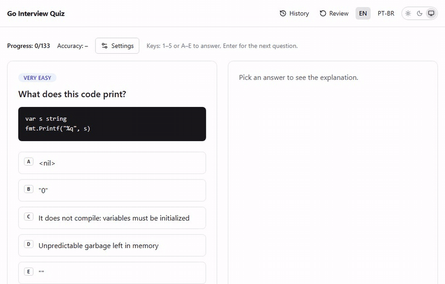
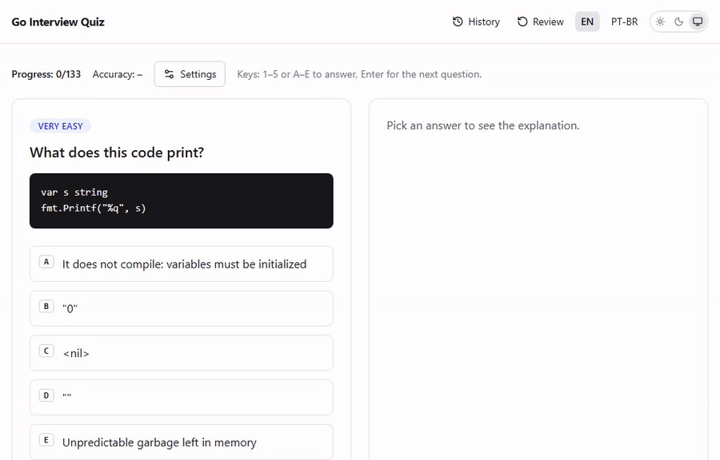
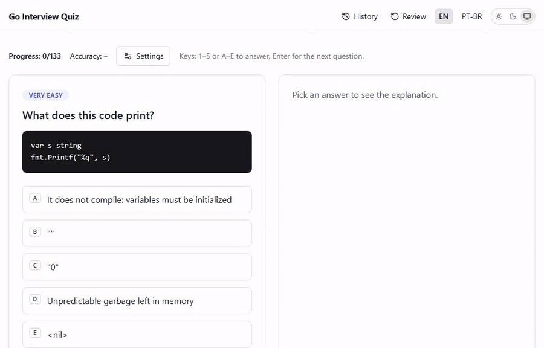
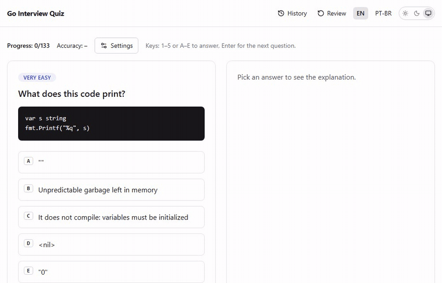
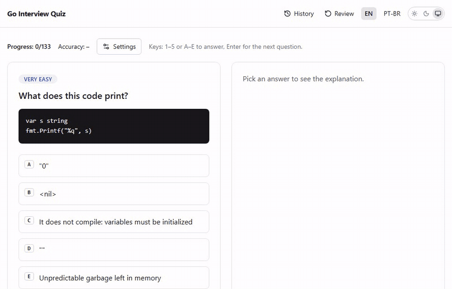
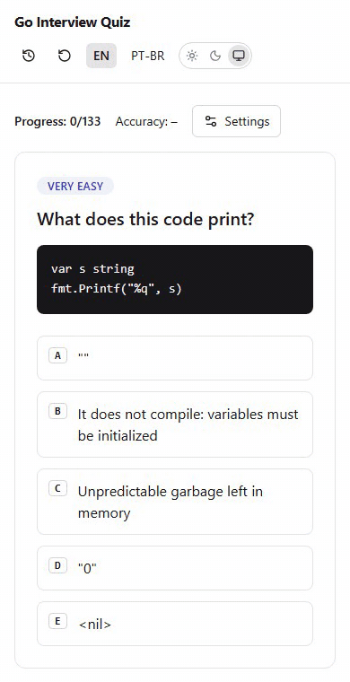

<div align="center">

<h1><strong><a href="https://quiz.vukem.dev" style="text-decoration: none" target="_blank">Vukem Interview Quiz</a></strong></h1>

[](https://github.com/AlexGalhardo/vukem-quiz/actions/workflows/ci.yml)
[](LICENSE)
[](go.mod)
<a href="https://github.com/AlexGalhardo/vukem-quiz/releases"></a>
<a href="https://scorecard.dev/viewer/?uri=github.com/AlexGalhardo/vukem-quiz"></a>

<h3><strong>Open Source Go Interview Questions, from Very Easy to Very Hard</strong></h3>

</div>

## Introduction

Vukem Interview Quiz is an open source, interactive quiz of Go (Golang) interview questions, from very easy to very hard. Every question has five alternatives, an explanation of each option and links to its sources, in English and Brazilian Portuguese. It runs in production at <https://quiz.vukem.dev> and is one of the battle tests for Vukem 1.0.

This application is built using the [Vukem Go framework](https://vukem.dev), with htmx 4 and Tailwind CSS v4.

- **Learn by explanation.** Every alternative says why it is right or wrong and links the spec, the docs or the Go blog.
- **Hypermedia, not a SPA.** The server renders HTML and htmx swaps fragments; the only client state is `localStorage`.
- **Secure by default.** Every item of the [security checklist](PLAN.md#security-checklist) has a test.
- **Windows is first-class.** Pure Go, no C compiler; developed on Windows 11, deployed on Linux.

## Summary

- [Introduction](#introduction)
- [Features](#features)
- [See it working](#see-it-working)
- [Quick start](#quick-start)
- [Documentation](#documentation)
- [Stability](#stability)
- [Contributing](#contributing)
- [Code of conduct](#code-of-conduct)
- [Security vulnerabilities](#security-vulnerabilities)
- [License](#license)

## Features

| Area | What you get |
| --- | --- |
| **Question bank** | 133 questions in 7 topic shards (very easy 24, easy 31, medium 30, hard 24, very hard 24), every snippet run on Go 1.27, every source link checked, embedded in the binary. |
| **Quiz flow** | Lands straight on a question; alternatives shuffled server-side on every request; answers lock the options and show the explanation card; deep links and back button work. |
| **Modes and stats** | Ordered or random queue, difficulty filter, review of wrong answers only, progress X/N and accuracy overall and per difficulty, reset with confirmation. |
| **Languages and themes** | EN and PT-BR (`?lang=` or `Accept-Language`), dark and light themes with no flash on load. |
| **Keyboard and accessibility** | `1`–`5` / `A`–`E` to answer and `Enter` for the next question; axe scans on every page state with zero serious or critical violations; Lighthouse 100 on mobile. |
| **Privacy** | No accounts, no database, no cookies: progress stays in `localStorage`; optional cookieless analytics (Plausible or Umami). |
| **Security** | Strict nonce-based CSP, per-IP rate limit, GET-only routes, allowlisted params, an OWASP abuse test suite, ZAP and Nuclei scans in CI. |
| **Operations** | One static binary with views and assets embedded, `/up` health check, Docker image on GHCR, Railway deploy, a human-like QA suite and a smoke script for any deployment. |

| Layer | Choice |
| --- | --- |
| Backend | Go 1.27.3, Vukem (`html/template` views, i18n, rate limit, secure headers) |
| Frontend | htmx 4.0.0 (vendored), Tailwind CSS 4.3.3, TypeScript 7.0.2, Vite 8.3.4 |
| Data | None: questions are JSON shards embedded in the binary, progress lives in the browser |
| Tooling | Bun 1.4.3, Playwright 1.64.1, axe, golangci-lint v2.15.0, govulncheck v1.9.0, lefthook, commitlint, markdownlint-cli2 |
| Hosting | Railway (Docker image `alpine:3.24.2`, built with the `vukem_nosqlite` tag), images on GHCR |

## See it working

<details>
<summary><strong>Show the GIFs (6)</strong></summary>

### Answer and learn

Pick an alternative (or press `1`–`5`) to lock the options and see why each one is right or wrong, with sources.



### Progress and accuracy

Progress X/N and accuracy overall and per difficulty, kept in `localStorage`.



### Difficulty filter



### English and Brazilian Portuguese



### Dark and light themes



### Mobile



All GIFs are recorded against <https://quiz.vukem.dev> (read-only: progress lives in the browser).

</details>

## Quick start

Requirements: Go 1.27.3, Bun 1.4.3 and Docker (optional).

```sh
bun install                  # JS deps + git hooks
docker compose up            # http://localhost:3000 (Go app with reload + Vite dev server)
curl http://localhost:3000/up
```

Without Docker: `cp .env.example .env`, then `bun run dev` and `go run ./cmd/app` in two terminals.

Configuration is in [.env.example](.env.example). Production needs `APP_ENV=production`, `APP_KEY` and `APP_URL`; Railway sets `PORT`. Analytics is off unless `ANALYTICS_PROVIDER` is set. The [Dockerfile](Dockerfile) builds a single static binary with views and assets embedded (`docker compose --profile prod up --build prod` serves it on :8080), and [railway.json](railway.json) configures Railway (Dockerfile builder, `/up` health check).

## Documentation

- [PLAN.md](PLAN.md): briefing, decisions, architecture, routes, security checklist, roadmap.
- [docs/questions-style-guide.md](docs/questions-style-guide.md): how questions are written and sourced.
- [docs/qa-checklist.md](docs/qa-checklist.md): QA checklist, runs and findings.
- [AGENTS.md](AGENTS.md) and [CLAUDE.md](CLAUDE.md): rules for coding agents. The project is developed with AI coding agents; the path-scoped rules in `.claude/rules/` and the skills in `.claude/skills/` describe the conventions, the test-first workflow and the security contract every change follows.

## Stability

Vukem Interview Quiz follows [Semantic Versioning](https://semver.org) and tags releases as `vX.Y.Z` on `main`. Releases are published on [GitHub Releases](https://github.com/AlexGalhardo/vukem-quiz/releases).

Changes are listed in [CHANGELOG.md](CHANGELOG.md), which follows [Keep a Changelog](https://keepachangelog.com/en/1.1.0/) and links every entry to its commit.

## Contributing

Thank you for considering a contribution to Vukem Interview Quiz.

- Write the test first. Run the specific test, lint and typecheck that cover your change.
- New questions follow the [style guide](docs/questions-style-guide.md): run the snippet on Go 1.27 and check every source link.
- Update `CHANGELOG.md` and the documentation in the same change when behaviour, commands or conventions change.

```sh
golangci-lint run ./... && go test -race ./...
bun run typecheck && bun run test:unit && bun run build && bunx markdownlint-cli2
bun run test:e2e             # Playwright (starts the app)
go run ./internal/tools/quizcheck
```

The QA suite, the smoke script and the e2e run against the production binary are described in [AGENTS.md](AGENTS.md#commands). The full guide is in [CONTRIBUTING.md](CONTRIBUTING.md).

### Pull requests

1. Create a branch from `main`.
2. Make one logical change per commit.
3. Open a pull request against `main`.

`main` accepts changes through a pull request with green checks and linear history.

### Commits

Use [Conventional Commits](https://www.conventionalcommits.org/en/v1.0.0/) in English: `type(scope): description`.

- Types: `feat`, `fix`, `perf`, `refactor`, `docs`, `test`, `build`, `ci`, `chore`, `style`, `revert`.
- Scopes: `quiz`, `questions`, `ui`, `i18n`, `security`, `docker`, `ci`, `deps`, `repo`, `docs`, `release`.

`bun install` installs the lefthook git hooks: commitlint checks the header locally, and CI checks the commits and the pull request title.

## Code of conduct

To keep the community welcoming to everyone, please review and follow the [Code of Conduct](CODE_OF_CONDUCT.md).

## Security vulnerabilities

If you discover a security vulnerability, please follow the [security policy](SECURITY.md) instead of opening a public issue.

## License

Vukem Interview Quiz is open source software released under the [MIT license](LICENSE).
